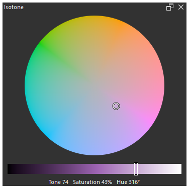

# Isotone

A color picker for Krita where the hue always remains the same!

requires krita 5.3+ in the 5.x line

## Install

1. download **isotone-X.Y.Z.zip** from the latest [release](../../releases/latest)
2. in *Krita: Tools > Scripts > Import Python Plugin from File* and pick the zip
3. restart krita...
4. Settings > Dockers > Isotone
5. enjoy!

> [!WARNING]
> If the plugin does not show up, check that it is enabled in
`Settings > Configure Krita > Python Plugin Manager`

## Dev notes

    python scripts/install.py link

| Command|???|
|---|---|
| python scripts/install.py link | link the plugin into kritaas pykrita folder |
| python scripts/install.py copy| install a standalone copy|
|python scripts/install.py remove | uninstall -> link is removed without touching the source |
|python scripts/build_bundle.py --version v1.2.3 | build dist/isotone-1.2.3.zip as published in releases |
|python scripts/next_version.py | print the tag the next merge to main would get|

install.py finds the pykrita folder on Windows, macOS and Linux; pass --pykrita dir to override it.

Checks, the same as CI runs:

    pip install -r requirements-dev.txt
    python -m unittest discover -s tests
    ruff check .
    ruff format --check .

!!! restart krita after changing the code. python erorrs appear in a popup on startup
and in Help > Show Krita log for bug reports.

## License

[MIT](LICENSE)
